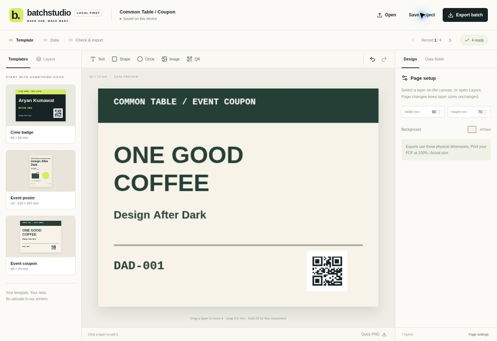

# BatchStudio

**Design once. Generate a whole batch.** An MIT-licensed, local-first template and data design studio by Aryan Kumawat.

Build editable badges, event posters and coupons, connect a CSV, check every record, then export personalized artwork. No API key or paid service is needed.



## Run locally

Requires Node 22.13+ (Node 24 recommended).

```sh
npm ci
npm run dev
```

Open the URL printed by the dev server. `npm test` runs the 22 core tests. `npm run build` creates the Worker build; the included Sites adapter supports the hosted edition.

## Make your first batch

1. Choose Crew badge, Event poster or Event coupon.
2. Open **Data fields → Import CSV**, or edit the included sample records.
3. Select a text or QR layer and use `{{name}}`, `{{code}}` or another exact CSV header. For images, upload PNG/JPEG/WebP files and bind their filenames.
4. Drag layers, resize unrotated layers, or enter exact millimetres in the inspector. Text supports wrapping and optional shrink-to-fit.
5. Open **Check & export** to resolve missing values, overflowing text and missing images.
6. Export a PNG, ZIP with a per-record manifest, or an actual-size PDF with optional A4/Letter imposition and crop marks.

Try [crew.csv](public/examples/crew.csv) or open one of the complete `.batchstudio.json` examples in `public/examples/`.

## Features

- Three original, fully editable templates; text, rectangles, ellipses, local images and QR layers.
- Layer ordering, duplication, locking, rotation, snap-to-grid, 50-step undo/redo.
- CSV parsing with quoted cells/newlines, field insertion and editable records.
- Per-record preflight with errors, warnings and explicit skipping of invalid records.
- PNG at 96/150/180/300 DPI; ZIP manifest; raster PDF with physical page dimensions.
- Local IndexedDB autosave and portable JSON projects containing template, data and images.
- Responsive editor, no remote fonts, no analytics and no application endpoint receiving your design data.

## Boundaries of this first release

Projects support 500 CSV records, 40 columns, 60 layers and 12 embedded images (1 MB each). Exports support 100 records per batch, 20 megapixels per design and 100 MB of rendered images. CSV must be UTF-8. Empty referenced fields are preflight errors.

PDF artwork is raster RGB at the selected DPI: no CMYK, bleed, embedded editable text or professional prepress guarantees. Print at **100% / Actual size**. Four system font families are available; appearance can vary across operating systems. Font fallback is browser-dependent. QR content is limited to 512 UTF-8 bytes; always scan your final printed codes before production.

Autosave belongs to the current browser and site origin. Download project backups; clearing browser storage removes local saves. The hosted app needs an initial network load. There is no collaboration, cloud document sync or AI image generation.

## Architecture

`lib/model.mjs` owns the validated versioned project schema and CSV parser. `lib/layout.mjs` handles text layout and record diagnostics. `lib/render.mjs` draws preview/export canvases. `lib/export.mjs` creates PNG, ZIP and PDF output. `components/` provides the React editor; `lib/storage.mjs` keeps local saves. The UI and exports share the rendering and text-layout paths.

Built with React, Vinext, Canvas, qrcode, pdf-lib and fflate. Dependencies retain their respective licenses.

## Contributing

Run `npm test`, exercise an export in a browser, and describe observable behavior in your pull request. Priorities: keyboard canvas controls, custom fonts, SVG/vector PDF, bleed guides, reusable user template galleries and an accessible mobile workflow. Do not add telemetry or upload user artwork without an explicit product decision.

## License

MIT © 2026 Aryan Kumawat. Original code and templates; no proprietary design assets are included.
